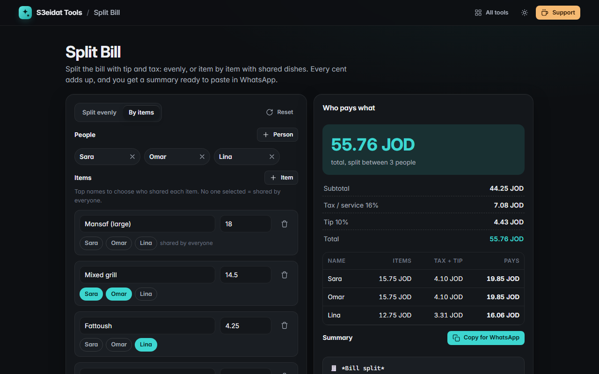

# Split Bill

> Split the bill and tip between friends, evenly or item by item. Free, private, and it runs entirely in your browser.

### ▶ [Open Split Bill](https://s3eidat.github.io/split-bill/)



## Features

- **Split evenly** between any number of people, or **by items**: add people and dishes, tap who shared each one
- **Shared items**: an item nobody is tagged on is shared by everyone; tagged items are split between those people only
- **Tip** presets (0–20%) or any custom %, optionally on the amount after tax
- **Tax / service charge** spread fairly in proportion to what each person ordered
- **Every cent adds up**: leftovers go to individual people so the shares always equal the total exactly
- **Rounding**: round each share up to 0.05, 0.10, 0.25, 0.50, 1 or 5, and see the extra it collects
- **Copy for WhatsApp**: a clean summary with *bold* amounts, ready to paste in the group
- Your currency label, and everything remembered on this device

## Privacy

Your numbers never leave your device. There is no server, no account, no analytics.
The page ships with a strict Content-Security-Policy (`connect-src 'self'`), so the browser
itself blocks any attempt to send data anywhere.

## Run it yourself

It's plain HTML, CSS and JavaScript with no build step:

```bash
git clone https://github.com/s3eidat/split-bill
cd split-bill
python -m http.server 8000
```

Then open http://localhost:8000.

## Support

If this saved you time, **[buy me a coffee ☕](https://s3eidat.github.io/coffee/)**. It keeps every tool free.

---

Part of **[S3eidat Tools](https://s3eidat.github.io/)**: 100+ free, private tools that run in your browser. MIT licensed.
